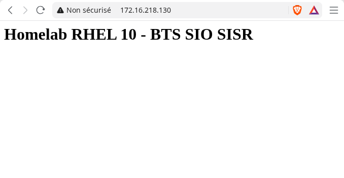

# Serveur web Apache sur RHEL 10.3

## Objectif
Installer Apache (httpd), ouvrir le port 80 dans firewalld
et vérifier l'accès depuis un autre poste.

## Commandes utilisées
- sudo dnf install -y httpd
- sudo systemctl enable --now httpd
- sudo firewall-cmd --add-service=http --permanent
- sudo firewall-cmd --reload

## Résultats
- Avant l'ouverture du port : connexion refusée (docs/test-avant.txt)
- Après l'ouverture du port : page affichée (docs/test-apres.txt)
- Pare-feu avant et après : docs/firewall-avant.txt, docs/firewall-apres.txt
- État du service : docs/httpd-status.txt

## Ce que j'ai appris
- Apache répond en local, mais firewalld bloque le port 80 pour les autres postes
- Un curl lancé depuis la VM elle-même ne passe pas par le pare-feu :
  il faut tester depuis un autre poste
- --permanent enregistre la règle, --reload l'applique
